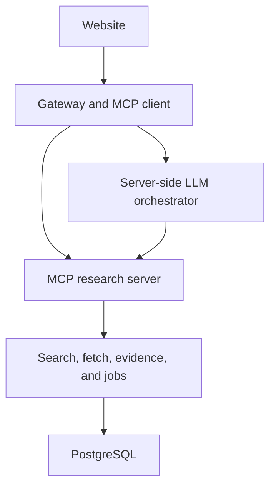

# News Trace

Explore how a news story appeared and developed across posts, articles, and websites, then ask questions about the evidence.

**Status:** Specification and repository bootstrap stage. Application code and a live deployment are not included with these documents. The first implementation milestone is defined in [FIRST_COMMIT_PROMPT.md](FIRST_COMMIT_PROMPT.md); completed capabilities and verified run commands must be added here as implementation progresses.

## What the product does

1. A user submits a research question and a source URL.
2. The backend searches for related reporting, direct references, original announcements, and earlier evidence through MCP tools.
3. The website displays a chronological tree with each item's publication date, time, and source.
4. The user selects two nodes and asks a question about them.
5. A server-side LLM requests specific details or additional sources through MCP and returns an answer with inspectable citations.

The submitted URL is a **discovery seed**, not necessarily the tree root. The root is the earliest traceable relevant evidence the system finds. The UI labels this “Earliest evidence found” and explains uncertainty and search limits; it does not claim exhaustive knowledge of the entire internet.

## Chronology and evidence

- Order comparable publication times from earlier to later. Highlight the submitted source wherever it belongs.
- Preserve unknown times, date-only values, and unknown timezones. Retrieval time is separate from publication time.
- Distinguish direct links/references from inferred relevance.
- Preserve multiple parents and cycles as cross-links behind the tree view.
- A chronological placement connector does not prove citation, influence, or causation.
- If an earlier source is discovered later, update the origin assessment and notify the user before rerooting.
- Answers cite immutable source snapshots. Additional discoveries are added to the tree only after a user chooses to add them.

## Specifications

| Document | Responsibility |
|---|---|
| [News_Graph_Implementation_Contract.md](News_Graph_Implementation_Contract.md) | Frontend behavior, chronological tree, node selection, questions, citations, and UI acceptance criteria |
| [Question_Source_MCP_Agent_Contract.md](Question_Source_MCP_Agent_Contract.md) | Gateway/backend, MCP tools, discovery, source metadata, origin assessment, LLM tool use, persistence, and backend acceptance criteria |
| [FIRST_COMMIT_PROMPT.md](FIRST_COMMIT_PROMPT.md) | Instructions for creating a focused first implementation commit |

Use **version 2.1 or newer** of both contracts. Earlier versions assumed either a supplied backend, single-page-only analysis, or a tree rooted at the submitted source; those assumptions are superseded. Backend schemas own shared data contracts; the frontend contract owns UI behavior. Resolve conflicts explicitly instead of maintaining two incompatible types.

## Architecture

The browser uses an authenticated same-origin HTTP API. MCP is the constrained interface to research operations; search providers and source fetchers supply the data. The LLM can request node details, relationship evidence, related-source search, and candidate retrieval. It cannot execute arbitrary code or change the tree on its own.

## Proposed stack

| Layer | Baseline |
|---|---|
| Frontend | React, TypeScript, Vite, hierarchical graph renderer such as Cytoscape.js |
| Gateway/backend | Python, FastAPI, Pydantic |
| MCP | Official SDK, Streamable HTTP |
| Storage | PostgreSQL |
| Background work | Celery and Redis |
| Retrieval | Search-provider adapter, HTTP fetcher, Trafilatura extraction |
| Analysis | Configurable LLM adapter with bounded tool calling |

These are design choices. Pin and test compatible dependency versions during implementation; no specific unverified SDK API is prescribed here.

## Planned repository layout

| Path | Purpose |
|---|---|
| `apps/web/` | Frontend application |
| `backend/src/news_trace/` | Gateway, MCP server, domain models, worker, and provider adapters |
| `backend/tests/` | Backend and MCP integration tests |
| `contracts/generated/` | Generated shared JSON Schema and frontend types |
| `fixtures/` | Synthetic sources, relationships, timestamps, and expected answers |
| `docs/` | Architecture decisions, implementation status, and operational notes |
| `scripts/` | Verified development and schema-generation commands |

The four Markdown documents supplied here belong at the repository root so their relative links work. Preserve an existing repository structure when adapting this plan.

## Getting started

At this stage, place the two contracts, this README, and the first-commit prompt together in the intended repository and give the agent [FIRST_COMMIT_PROMPT.md](FIRST_COMMIT_PROMPT.md).

The implementing agent must replace this paragraph with commands it actually verifies for dependency installation, fixture-mode startup, schema generation, tests, and production build. Do not document placeholder commands as if they already run.

Fixture mode must be clearly labeled, work without paid credentials, and exercise the same data contracts as live mode. Live discovery requires configured search and LLM providers. Keep all credentials server-side in untracked environment files; commit only examples with safe placeholders.

## Milestones

1. **First commit:** repository foundation, shared schemas, chronological projection tests, and a small working MCP-backed fixture explorer.
2. **Research jobs:** persisted discovery, source extraction, origin tracing, expansion, and cancellation.
3. **Two-node questions:** bounded LLM/MCP tool loop, evidence validation, citations, and additional findings.
4. **Live release:** actual providers, ownership/access controls, failure recovery, browser checks, and acceptance evidence.

The first commit is a foundation milestone, not a claim that the complete product passes all acceptance criteria. Track implemented, fixture-only, and pending behavior separately.

## Product invariants

Never fabricate source content, connections, publication dates, origin certainty, or citations. Keep credentials outside the browser. Validate outbound destinations and ownership before retrieval. Preserve citation snapshots and selected-node identity across graph updates. Treat search results and source content as untrusted data.

The contracts contain the full requirements and release acceptance gates.
