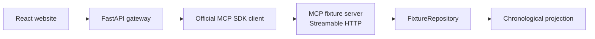

# News Trace

Explore how a news story appeared and developed across posts, articles, and websites, then ask questions about the evidence.

**Status:** First milestone implemented — a fixture-backed chronological explorer. The browser loads a synthetic
research graph through a FastAPI gateway and a real MCP server over Streamable HTTP. Live discovery, source fetching,
durable research jobs, node questions, LLM orchestration, and citations are explicitly **not implemented yet**.
See [docs/IMPLEMENTATION_STATUS.md](docs/IMPLEMENTATION_STATUS.md) for the acceptance-by-acceptance boundary and
[docs/ARCHITECTURE.md](docs/ARCHITECTURE.md) for module and chronology decisions.

## What the product does

1. A user submits a research question and a source URL.
2. The backend searches for related reporting, direct references, original announcements, and earlier evidence through MCP tools.
3. The website displays a chronological tree with each item's publication date, time, and source.
4. The user selects two nodes and asks a question about them.
5. A server-side LLM requests specific details or additional sources through MCP and returns an answer with inspectable citations.

The submitted URL is a **discovery seed**, not necessarily the tree root. The root is the earliest traceable relevant evidence the system finds. The UI labels this “Earliest evidence found” and explains uncertainty and search limits; it does not claim exhaustive knowledge of the entire internet.

## Chronology and evidence

- Order comparable publication times from earlier to later. Highlight the submitted source wherever it belongs.
- Preserve unknown times, date-only values, and unknown timezones. Retrieval time is separate from publication time.
- Distinguish direct links/references from inferred relevance.
- Preserve multiple parents and cycles as cross-links behind the tree view.
- A chronological placement connector does not prove citation, influence, or causation.
- If an earlier source is discovered later, update the origin assessment and notify the user before rerooting.
- Answers cite immutable source snapshots. Additional discoveries are added to the tree only after a user chooses to add them.

## Specifications

| Document | Responsibility |
|---|---|
| [News_Graph_Implementation_Contract.md](News_Graph_Implementation_Contract.md) | Frontend behavior, chronological tree, node selection, questions, citations, and UI acceptance criteria |
| [Question_Source_MCP_Agent_Contract.md](Question_Source_MCP_Agent_Contract.md) | Gateway/backend, MCP tools, discovery, source metadata, origin assessment, LLM tool use, persistence, and backend acceptance criteria |

Use **version 2.1 or newer** of both contracts. Earlier versions assumed either a supplied backend, single-page-only analysis, or a tree rooted at the submitted source; those assumptions are superseded. Backend schemas own shared data contracts; the frontend contract owns UI behavior. Resolve conflicts explicitly instead of maintaining two incompatible types.

## What is implemented in this milestone

- Authoritative Pydantic shared models and a committed JSON Schema.
- Generated frontend TypeScript DTOs from that schema (no hand-maintained copies).
- Deterministic chronological projection with provenance-preserving uncertainty handling:
  - seed and root are independent;
  - old background and inaccessible sources are excluded from origin eligibility;
  - equal/date-overlapping candidates produce a provisional origin;
  - missing dates and timezones are preserved; no invented midnight UTC;
  - unresolved chronology yields `root_node_id = null`;
  - traced relationships are distinct from chronological-only placement;
  - backward links and cycles remain cross-links;
  - discovering an earlier source changes the root/revision but preserves node IDs.
- A deterministic synthetic fixture with 16 initial sources (17 with the expanded stage), covering posts, news,
  webpages, ties, date-only values, timezone-unknown local times, missing dates, unavailable content, duplicate
  syndication, multiple citations, multiple parents, and a cycle.
- A real official-SDK MCP server over Streamable HTTP exposing typed `get_research_graph` and `get_node_details`.
- A FastAPI gateway that reaches MCP only through the official SDK client. Both read routes and honest
  MCP-unavailable/live-mode errors are implemented.
- A React/Vite fixture explorer with:
  - a Cytoscape chronological tree plus an accessible outline/source list;
  - honest publication labels and separate retrieval time;
  - “Submitted source” and “Earliest evidence found” badges;
  - time-uncertain/undated lane;
  - cross-link display and a node detail panel;
  - exactly-two-node A/B selection with clear/swap and explicit third-node replacement;
  - responsive Tree / Sources / Ask tabs;
  - a persistent “Synthetic demo” badge.
- The node-question action is disabled with a specific “not implemented in this milestone” explanation. It does
  not pretend to run.

### Explicitly pending

- Live search-provider and page-fetch adapters, extraction, and real discovery.
- PostgreSQL persistence, Celery/Redis jobs, cancellation, recovery, and graph mutation.
- Node expansion as a user-triggered job/UI flow.
- Two-node LLM question jobs, MCP tool loops, validated citations, and additional-findings insertion.
- Production authentication/ownership/CSRF and deployment.
- Live acceptance credentials and the full 500-node/1,500-edge performance gate.

## Architecture



For this milestone, public browser routes are same-origin GETs. The gateway has no direct fixture access; the MCP
read path is mandatory and tested. See [docs/ARCHITECTURE.md](docs/ARCHITECTURE.md) for the full module table,
SDK version, schema pipeline, chronology decisions, and security posture.

## Repository layout

| Path | Purpose |
|---|---|
| `frontend/` | New Traceback React/TypeScript/Vite contract UI; gateway demo is the default read path |
| `apps/web/` | Legacy Cytoscape contract UI retained for comparison |
| `backend/src/news_trace/` | Shared models, projection, fixture repository, MCP server/client, FastAPI gateway |
| `backend/tests/` | Model/projection tests plus real MCP and gateway integration tests |
| `contracts/generated/` | Generated JSON Schema and frontend types |
| `fixtures/` | Synthetic deterministic research fixtures |
| `docs/` | Architecture and implementation status |
| `scripts/` | Contract generation, fixture startup, and verification helpers |

## Prerequisites

Verified in this environment:

- Python 3.14.7 (the backend requires Python 3.11 or newer)
- [uv](https://docs.astral.sh/uv/) 0.13.8 (install with `python -m pip install uv` if it is not already available)
- Node.js 24.22.1 and npm 11.19.1 (Vite requires Node 22.12 or newer; the jsdom 31 test dependency requires
  Node 22.22.2 or newer on the 22.x line)
- Windows PowerShell for the commands below; POSIX equivalents are shown where they differ

No paid provider credentials are required. Fixture mode is local and explicit.

## Setup and run

1. Create local configuration:

   ```powershell
   Copy-Item .env.example .env
   ```

   POSIX: `cp .env.example .env`

   `.env` is ignored by Git. `.env.example` contains only safe local placeholders. Do not add provider keys to a
   tracked file.

2. Install backend dependencies and create the lockfile-based environment:

   ```powershell
   cd backend
   uv sync
   cd ..
   ```

   This creates `backend/.venv` from `backend/uv.lock`. The frontend lockfiles are
   `frontend/package-lock.json` and `apps/web/package-lock.json`.

3. Start the MCP server and gateway in one terminal:

   ```powershell
   uv run --project backend python scripts/run_fixture.py
   ```

   If `uv` is not on `PATH`, use the existing virtual environment directly:

   ```powershell
   backend\.venv\Scripts\python.exe scripts\run_fixture.py
   ```

   Expected local endpoints:

   - gateway health: `http://127.0.0.1:8000/health`
   - gateway API: `http://127.0.0.1:8000/api/v1/...`
   - MCP Streamable HTTP: `http://127.0.0.1:8765/mcp`

   Check health:

   ```powershell
   Invoke-RestMethod http://127.0.0.1:8000/health
   ```

   POSIX: `curl http://127.0.0.1:8000/health`

4. In a second terminal, install the new frontend dependencies and start Vite:

   ```powershell
   npm --prefix frontend install
   npm --prefix frontend run dev
   ```

   Open `http://127.0.0.1:5173`. Vite proxies `/api` and `/health` to the gateway, so the browser uses same-origin
   requests. The default **Load synthetic Riverbend demo** loads graph and node details through the gateway/MCP read
   path. Use `http://127.0.0.1:5173/?demo=1&transport=bundled` for the fully offline interactive demo. A persistent
   **Synthetic demo** label identifies fixture data in both modes.

   The legacy UI remains available with `npm --prefix apps/web install` and `npm --prefix apps/web run dev`.

### Fixture entry point

The new frontend loads the documented fixture research id `fixture-riverbend` from:

- `GET /api/v1/research/fixture-riverbend/graph`
- `GET /api/v1/research/fixture-riverbend/nodes/{node_id}`

Those read routes cross the real gateway → MCP → `FixtureRepository` path. The demo is read-only in gateway mode:
discovery, job, expansion, question, and additional-discovery routes return explicit typed `503`/`404` responses
instead of fabricated results. The bundled offline demo (`?demo=1&transport=bundled`) keeps the complete local
synthetic interaction flow.

The fixture repository also exposes an expanded projection stage to tests; it demonstrates the April agenda arriving
later and rerooting the graph without changing node IDs. The bundled demo simulates that expansion client-side; it is
not a backend job yet.

## Checks

Run from the repository root unless noted. Do not treat a check as passed unless the command completed successfully.

```powershell
# Backend models, projection, fixture, MCP-over-HTTP, and gateway tests
uv run --project backend pytest -q

# Shared JSON Schema is current
uv run --project backend python scripts/generate_contracts.py --check

# Regenerate frontend types; then confirm the committed file did not change
npm --prefix apps/web run generate:types
git diff --exit-code -- apps/web/src/generated/newsTraceContracts.ts

# New Traceback UI behavior tests, DTO sync, typecheck, and production build
npm --prefix frontend run check:contracts
npm --prefix frontend test
npm --prefix frontend run typecheck
npm --prefix frontend run build

# Legacy UI behavior tests, typecheck, and production build
npm --prefix apps/web test
npm --prefix apps/web run typecheck
npm --prefix apps/web run build
```

Or run the convenience runner:

```powershell
uv run --project backend python scripts/check.py
```

The runner covers schema/type freshness, backend tests, both frontend test suites, typecheck, and production builds.
It does not start servers. For the real-browser checks, start the backend, build the new frontend, and serve its
production preview on port 4173:

```powershell
npm --prefix frontend run build
npm --prefix frontend run preview -- --host 127.0.0.1 --port 4173
# in a second terminal:
npm --prefix frontend run smoke:browser
npm --prefix frontend run smoke:browser:gateway
```

The first smoke uses the bundled offline demo and asserts no backend requests. The gateway smoke asserts graph and
node-detail reads reach `/api/v1/research/...`. Both use the installed Microsoft Edge through `playwright-core`; they
do not download a browser.

The exact results for this commit are recorded in
[docs/IMPLEMENTATION_STATUS.md](docs/IMPLEMENTATION_STATUS.md#verification-log).

## Product invariants

Never fabricate source content, connections, publication dates, origin certainty, or citations. Keep credentials outside the browser. Validate outbound destinations and ownership before retrieval. Preserve citation snapshots and selected-node identity across graph updates. Treat search results and source content as untrusted data.

## Milestones

1. **First commit:** repository foundation, shared schemas, chronological projection tests, and a small working MCP-backed fixture explorer. **Implemented here, with the pending boundaries above.**
2. **Research jobs:** persisted discovery, source extraction, origin tracing, expansion, and cancellation.
3. **Two-node questions:** bounded LLM/MCP tool loop, evidence validation, citations, and additional findings.
4. **Live release:** actual providers, ownership/access controls, failure recovery, browser checks, and acceptance evidence.

The contracts contain the full requirements and release acceptance gates. The first milestone is a foundation, not
a claim that the complete product passes all acceptance criteria.
