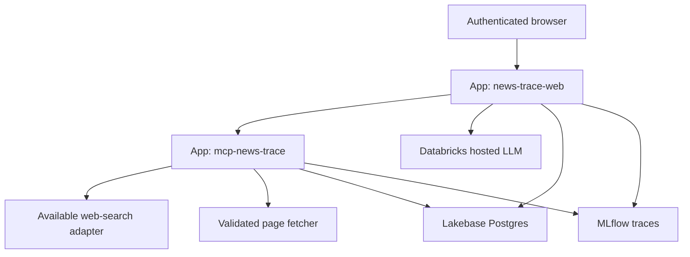

# News Trace — Databricks Free Edition Integration Plan

- **Researched:** November 14, 2026
- **Target:** Databricks Free Edition
- **Status:** Documentation-backed proposal; no workspace resources were inspected, provisioned, or deployed
- **Product baseline:** [Frontend](../News_Graph_Implementation_Contract.md) and [MCP](../Question_Source_MCP_Agent_Contract.md) contracts v2.1

## 1. Recommendation

Use **Lakebase Postgres for application state, Databricks Apps for the website and custom MCP server, Databricks Foundation Model APIs for the LLM, and MLflow for tool/answer tracing**. Attempt Databricks-managed web search first, but make that a capability check rather than an assumed dependency on Free Edition.

Preserve the product: a source URL is a discovery seed; the tree is chronological and starts at the earliest relevant evidence found; users select two nodes and ask an LLM that can request more evidence through MCP.

The first engineering milestone should prove cloud database access, authenticated App-to-App MCP calls, one hosted-model tool call, and a viable search-plus-fetch path. UI polish comes after these checks. If Free Edition blocks live discovery, report that constraint rather than presenting saved fixtures as a live search.

This plan is an infrastructure overlay for the existing contracts, not a new product specification. The proposed Redis/Celery and authentication changes are recorded in sections 8 and 9 for review before implementation. Keep HTTP routes, source/evidence models, chronology rules, and frontend behavior unchanged.

## 2. Research findings and product fit

| Databricks capability | Documentation finding | News Trace decision |
|---|---|---|
| Databricks Apps | Hosts Python/Node applications on serverless infrastructure [S1] | Two Apps: UI/gateway/orchestrator and custom MCP/research service |
| Lakebase | PostgreSQL-backed App resource; data persists across deployments [S2] | Primary transactional database for jobs, graph revisions, evidence, and answers |
| Foundation Model APIs | Preconfigured hosted-model endpoints; pay-per-token is the starting path [S3] | Use an available tool-capable model through Databricks; no custom GPU hosting |
| Managed web-search MCP | `system.ai.web_search` returns synthesis with citations, accepting a natural-language query [S4] | Candidate discovery adapter, followed by independent source retrieval/validation |
| Custom MCP on Apps | Starter template and HTTPS MCP endpoint are documented [S5] | Implement the contract's constrained research tools here |
| AI Search MCP | Semantic/hybrid retrieval over your indexed documents; managed embeddings required for this MCP [S6] | Optional retrieval over collected evidence, not public-web discovery |
| Unity Catalog / Unity Gateway | Govern registered tools and their access [S7] | Use permitted managed tools; do not expose broad SQL/shell tools to the answering model |
| Lakeflow Jobs | Apps can trigger and monitor configured workflows [S8] | Option for durable ingestion/backfill if its startup time suits the demo |
| MLflow Tracing | Automatic integrations and custom spans record model/tool activity [S9] | Show an auditable two-node question and its MCP calls in the demo |

Web search finds new internet URLs. Corpus retrieval searches collected content. The custom News Trace MCP checks ownership, extracts dates, preserves snapshots, and assembles relationships.

Genie/SQL MCP is useful for analytics on governed tables, but it does not replace the news-source discovery pipeline. A general code sandbox is unnecessary for answering node questions.

## 3. Free Edition feasibility and blockers

The Free Edition limitations documentation lists up to three Apps, one Lakebase project, one AI Search endpoint without Direct Vector Access, five concurrent job tasks, restricted outbound domains, limited model availability, and no account console. Apps stop after up to 24 hours and can be restarted. Quotas may pause compute. [S10]

1. **Search beta access:** The managed web-search service requires the Enhanced Unity Gateway account preview. Since Free Edition has no account console, self-enabling that preview cannot be assumed. Check whether the service is already exposed; otherwise choose a tested alternative. This is an inference from documented restrictions, not a workspace observation. [S4], [S7], [S10]
2. **Source access:** A search tool returning a URL does not prove that your App can fetch that URL. Test article retrieval from the deployed service, including redirects. The Free Edition documentation describes verification as providing limited AI Runtime access; it does not promise unrestricted egress. [S10]

Databricks Apps require authenticated access; anonymous public apps are not supported. Arrange judge access through supported account/App permissions or demonstrate from an authenticated session. [S11]

### First-hour capability checklist

Record pass/fail, resource identifiers, and safe error codes in `docs/DATABRICKS_CAPABILITIES.md` during the spike:

| Probe | Pass condition | If blocked |
|---|---|---|
| App hosting | Deploy a small health endpoint and open it | Resolve workspace permission/quota before building further |
| Lakebase | App identity inserts and reads a record; record survives redeploy | Resolve database resource/role configuration; do not silently substitute SQLite |
| MCP transport | Web App service principal calls research App MCP health/list-tools | Verify App permissions, authentication, and SDK compatibility |
| Hosted LLM | Available model performs a structured function/tool call | Try another available endpoint; record exact API/model capabilities |
| Web-search service | Discover tool schema and receive usable citation URLs | Test native hosted-model search, then a permitted external provider |
| Source fetch | Deployed research service retrieves representative source pages | Restrict demo corpus honestly or obtain an approved ingestion path/workspace |
| Demo access | Intended presenter/judge can open the App | Use an authenticated presentation or arrange account access |

Use these checks to decide whether the full live demo is feasible.

## 4. Proposed deployment

### App A: news-trace-web

Serve the built React assets and FastAPI gateway from one App origin. Include the server-side two-node LLM orchestrator. It invokes the research MCP with SDK clients and returns the existing job/graph/answer contracts to the browser.

Build frontend assets before deployment or through a verified supported build step. Use an explicit `app.yaml` command and deployment health endpoint. Databricks documents command/env configuration and resource-backed environment values; keep Docker Compose for local development. [S12]

### App B: mcp-news-trace

Start from the custom MCP template or deploy the existing SDK server. Expose the gateway tools and the four constrained LLM research tools. The published App endpoint ends in `/mcp`. The documented `mcp-` naming convention aids recognition in AI Playground. [S5]

Implement search normalization, source retrieval, evidence persistence, and chronological projection behind this boundary. Validate all search-discovered URLs just as strictly as submitted URLs.

Keep one codebase with shared domain models and separate deployment roots. Reserve any remaining App capacity for diagnostics.

## 5. Database design

Use one Lakebase database with a `news_trace` schema and ordinary relational tables:

| Tables | Contents |
|---|---|
| `research_sessions` | User/owner, question, seed ID, origin assessment, current graph revision |
| `nodes` / `source_snapshots` | Canonical URLs, publisher/platform, publication precision, immutable extracted text/hash |
| `evidence` / `relationships` | Exact source spans, link/metadata evidence, typed directional/inferred links |
| `graph_revisions` / `tree_placements` | Versioned chronology, provisional root, cross-links, uncertain-time placement |
| `jobs` / `job_events` | Idempotent mutation IDs, state, leases, progress, cancellation, retry information |
| `question_runs` / `answers` | Selected snapshot pair, model configuration, cited statements, additional candidates |
| `tool_runs` / `usage_reservations` | Bounded tool activity, quota reservations, safe audit metadata |

Interactive state benefits from transactional constraints and atomic updates. Keep analytical Delta tables optional. If analytics are needed later, export a copy of normalized events or source chunks while retaining Lakebase as the authoritative application state.

Add Lakebase Autoscaling as an App resource where available. Each consuming App needs its own granted database role. The documented App environment includes `PGHOST`, `PGDATABASE`, `PGPORT`, `PGUSER`, and `PGSSLMODE`. Keep credentials server-side. [S2]

OAuth database tokens expire hourly. Follow the official App connection example to refresh credentials on new connections and recover stale pool connections. Test reconnection after rotation. Use the direct endpoint pattern from the tutorial and verify pooling compatibility. [S13]

Start with indexed metadata and PostgreSQL full-text lookup for small stored corpora. Verify extension support and synchronization options before relying on pgvector or automatic Lakebase-to-AI-Search updates.

## 6. Search MCP integration and fallbacks

### Preferred if accessible: Databricks web-search MCP

Documented service URL: `https://<workspace-hostname>/ai-gateway/mcp-services/system.ai.web_search`.

It requires service execution and catalog/schema privileges. The natural-language-only input does not offer a guaranteed structured date filter or complete result listing. Treat cited URLs as candidates. [S4]

1. Turn the question/seed context into bounded queries for original announcements, exact phrases, cited documents, and earlier coverage.
2. Invoke the service through the Databricks-compatible MCP client.
3. Normalize returned citation URLs, preserving tool provenance and any reported metadata separately.
4. Fetch permitted sources and extract publication evidence, quotations, canonical URLs, and hyperlinks.
5. Verify relationships and rebuild the chronological projection from extracted source evidence.

A date constraint in a natural-language query is a search hint. Recheck dates after retrieval. A synthesized search answer is not itself a source snapshot.

### Fallback order

| Option | When to use | Additional dependency |
|---|---|---|
| Native search on an available Databricks-hosted model | Managed search MCP is absent, but the selected model/API supports web search | Adapter wraps the actual native-search response into the candidate format |
| You.com through a permitted Databricks external MCP connection | A provider-backed route is available | Third-party key, connection permission, and any provider charges |
| Approved external retrieval/ingestion | Workspace cannot fetch source pages directly | External component; collection is no longer wholly within Databricks |
| Saved permitted evidence corpus | Live access cannot be resolved within the hackathon | Label replay/corpus mode; do not advertise live internet discovery |

Databricks documents native Gemini search and OpenAI Responses web search, plus a You.com MCP alternative requiring a provider key. Native OpenAI search is not a Chat Completions feature. Test workspace/model availability. [S4]

Some general API references and cloud-specific snippets differ on tool support. Prefer the feature-specific docs for the actual cloud/endpoint and confirm with a request. Keep native-search code separate from the custom-tool loop.

## 7. LLM hosting and two-node orchestration

Use a Foundation Model API already available in the workspace. Choose by testing structured tool arguments, returned tool-result handling, citation-shaped output, latency, and quota. [S3]

Attach the chosen serving endpoint as an App resource with CAN QUERY, and verify it is ready. Use supported SDK authentication from the App identity. [S14]

Application-owned loop:

- Pin both selected nodes and their evidence snapshots.
- Offer only `get_node_details`, `get_relationship_details`, `search_related_sources`, and `fetch_source_details`.
- Validate the model's requested arguments and perform real MCP calls.
- Return bounded results to the model, stopping at contract budgets.
- Validate final citations and persist the answer; additional findings remain separate until approved for insertion.

Prefer this explicit loop for consistent permissions and instrumentation even if a chosen model API can directly invoke remote MCP. Keep broad SQL, code execution, and unrelated workspace tools out of the model's allowed set.

Store conversation/tool state in Lakebase. Databricks' pay-per-token Responses documentation excludes stored-response continuation and background-response parameters; do not rely on `previous_response_id` for durable conversation state. [S15]

## 8. Jobs without adding Redis infrastructure

Proposed hackathon deviation from the generic contract: retain the job HTTP API and durable database state, but replace Redis/Celery dispatch with a **database-backed leased executor inside the research App** for short tasks. The application operates this queue.

Require atomic job creation, unique request IDs, claim/lease/heartbeat, a process-supervised executor, bounded concurrency, lease expiry recovery, transactional completion, and idempotent publication. On App stop, work may pause; resume from durable state after restart. Request-local fire-and-forget tasks cannot provide this recovery.

For longer collection/backfill, evaluate a Lakeflow Job triggered with the research ID. Apps support Job resources with permission to run/cancel workflows. Measure cold-start delay before putting interactive two-node questions on this path. [S8]

If the executor deviation is undesirable, keep the existing queue interface and use a verified worker deployment. Disclose external Redis if selected.

## 9. Authentication, permissions, and traces

Apps have distinct service principals and support app-identity and user-identity authorization. App credentials are injected by the platform. Preserve ownership checks in News Trace; use trusted identity context or supported user authorization across the gateway/MCP boundary. [S16]

Minimum intended grants:

- Web App identity: use research MCP App, query selected model endpoint, and write its approved application schema and trace experiment as needed.
- Research App identity: its Lakebase role, selected search MCP/connection, and necessary retrieval/trace resources.
- Judges/users: App access only as needed.

Use SDK credential refresh and secrets resources. Do not forward model tokens to source sites or trust browser-supplied owner headers. Test a second user/identity before claiming isolation.

Enable MLflow integration for the chosen client/framework and explicit spans around MCP calls, retrieval, origin determination, and citation validation. Record IDs, timings, token use, failures, and outcome quality. Redact private text and tokens. [S9]

For the demo, show the tree, select two sources, ask a question requiring another lookup, then show its model → MCP → evidence → answer trace.

## 10. Optional Databricks tools worth adding later

**AI Search:** Useful once many snapshots/chunks have been collected. The MCP searches your index, supports hybrid retrieval, and requires managed embeddings. It cannot discover pages absent from the index. [S6] Add an explicit export/index-update pipeline with node/snapshot/owner IDs, enforce ownership filters server-side, and keep index freshness visible.

**SQL/Genie:** Possible analytics extension for coverage by publisher, earliest-found sources, or tool costs. Keep it separate from the constrained evidence tools. The managed SQL MCP runs warehouse queries; verify access before assuming it reaches Lakebase tables. [S7]

**Lakeflow** can support batch refresh and replayable collection. **MLflow evaluation** could use a small reviewed set covering origin selection, temporal uncertainty, contradictory reporting, and cited two-node answers.

## 11. Implementation order and estimated effort

These are planning estimates for an agent-assisted prototype, excluding access delays.

| Phase | Work | Exit evidence | Estimate |
|---|---|---|---|
| 0 | Capability probes and judge access | Written pass/fail matrix; choose actual search/model path | 1–2 h |
| 1 | Two Apps, Lakebase schema, auth, hosted model | Persistent row, real MCP call, model tool call | 2–4 h |
| 2 | Discovery adapter, safe fetch, metadata/evidence, chronology | Seed newer than verified root; dated cited tree | 3–5 h |
| 3 | Existing React UI and two-node orchestration | Cited answer with a real additional-detail tool call | 3–5 h |
| 4 | Traces, replay dataset, restart tests, presentation | Repeatable live demo plus labeled fallback | 2–3 h |

Cut first if time is tight: corpus vector indexing, analytics dashboards, multi-platform custom scrapers, automated schedules, and sophisticated animations. Preserve chronology correctness, source evidence, two-node Q&A, actual MCP usage, and Databricks integration.

## 12. Changes to the existing repository plan

| Existing contract baseline | Databricks deployment overlay |
|---|---|
| Local PostgreSQL | Lakebase; keep local Postgres for tests |
| Generic host/Docker Compose | Two Databricks Apps; Compose remains local development only |
| Generic model endpoint | Verified Databricks Foundation Model API endpoint |
| Generic web search | Capability-selected Databricks managed/native search or explicitly documented fallback |
| Redis/Celery deployment | Proposed leased database executor for short demo jobs; optional Lakeflow for longer work |
| Generic internal service tokens | Databricks SDK/OAuth plus preserved per-user ownership context |
| Generic logs | MLflow traces and safe application events |

Add `docs/DATABRICKS_CAPABILITIES.md`, `docs/DATABRICKS_DEPLOYMENT.md`, one deployment root and `app.yaml` per App, database credential refresh, and provider adapter tests during implementation. Keep environment-specific resource IDs out of domain logic.

Start the Databricks work with the capability spike on top of the existing fixture milestone. The [implementation status](IMPLEMENTATION_STATUS.md) describes what is currently working.

## 13. Demo acceptance

- Website and custom MCP are reachable as authenticated Databricks Apps.
- App state persists in Lakebase across restart/redeploy; database credential refresh works.
- The selected LLM runs through Databricks and performs an actual constrained MCP detail call.
- Search mode is explicit: managed MCP, native hosted search, external provider, or corpus replay.
- At least one collected source has source-verified publication metadata and exact evidence.
- A newer submitted URL is placed after the earliest relevant evidence found; unknown dates remain unknown.
- The two-node answer cites the correct pinned source versions and identifies any additional sources.
- Browser payloads contain no secrets; unauthorized sessions cannot access another research object.
- Partial search/network failure, budget exhaustion, and App restart do not yield invented successful results.
- Presenter/judge access and a labeled saved-evidence fallback are tested before presentation.

**Decision:** Databricks is a fit for storage, hosting, model access, and observability. Fully live internet discovery on the Free Edition workspace remains conditional on the search and egress probes.

## 14. Primary research sources

The proposal used AWS Databricks documentation. Confirm the workspace cloud, region, and in-product availability before deployment.

- **S1:** [Databricks Apps][S1]
- **S2:** [Lakebase resources for Apps][S2]
- **S3:** [Foundation Model APIs][S3]
- **S4:** [Web search on Databricks][S4]
- **S5:** [Host an MCP server on Apps][S5]
- **S6:** [AI Search MCP][S6]
- **S7:** [Databricks-provided MCPs][S7]
- **S8:** [Lakeflow Jobs resources for Apps][S8]
- **S9:** [MLflow automatic tracing][S9]
- **S10:** [Free Edition limitations][S10]
- **S11:** [App permissions and sharing][S11]
- **S12:** [App runtime configuration][S12]
- **S13:** [Lakebase App connection and credential rotation][S13]
- **S14:** [Model-serving resources for Apps][S14]
- **S15:** [Databricks Responses API][S15]
- **S16:** [App authorization][S16]

[S1]: https://docs.databricks.com/aws/en/dev-tools/databricks-apps/
[S2]: https://docs.databricks.com/aws/en/dev-tools/databricks-apps/lakebase
[S3]: https://docs.databricks.com/aws/en/machine-learning/foundation-model-apis
[S4]: https://docs.databricks.com/aws/en/machine-learning/model-serving/web-search
[S5]: https://docs.databricks.com/aws/en/agents/mcp-tools/custom-mcp
[S6]: https://docs.databricks.com/aws/en/agents/mcp-tools/ai-search
[S7]: https://docs.databricks.com/aws/en/agents/mcp-tools/built-in-mcp-services
[S8]: https://docs.databricks.com/aws/en/dev-tools/databricks-apps/lakeflow
[S9]: https://docs.databricks.com/aws/en/mlflow3/genai/tracing/automatic-tracing
[S10]: https://docs.databricks.com/aws/en/getting-started/free-edition-limitations
[S11]: https://docs.databricks.com/aws/en/dev-tools/databricks-apps/permissions
[S12]: https://docs.databricks.com/aws/en/dev-tools/databricks-apps/app-runtime
[S13]: https://docs.databricks.com/aws/en/oltp/projects/tutorial-databricks-apps-autoscaling
[S14]: https://docs.databricks.com/aws/en/dev-tools/databricks-apps/model-serving
[S15]: https://docs.databricks.com/aws/en/machine-learning/model-serving/query-openai-responses
[S16]: https://docs.databricks.com/aws/en/dev-tools/databricks-apps/auth
